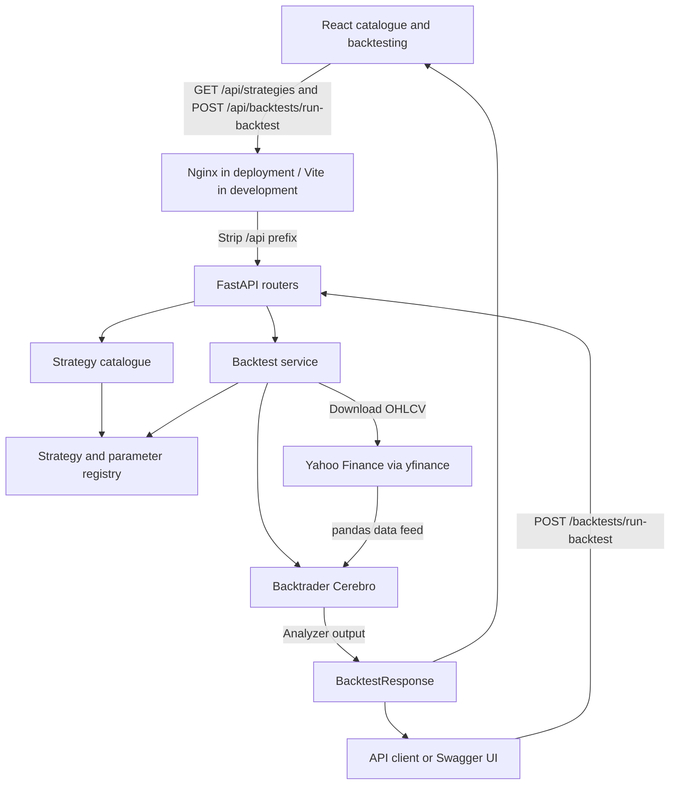

# Architecture

Hypothiq has two applications: a React/TypeScript client built with Vite and a
Python FastAPI service using Backtrader, pandas, and `yfinance`. There is no
database or background-job infrastructure in the current implementation.

## Product scope

Hypothiq is intended to support researching, sharing, creating, and testing
algorithmic trading strategies. This scope guides the architecture and
[roadmap](roadmap.md); it does not imply that all capabilities are implemented.
Today, users can discover predefined strategies and test them on historical
market data in the browser or through the API. Strategy creation and sharing
are planned work.

## Components and boundaries

The browser consumes the catalogue and backtest endpoints. The backtest API is
also usable independently through Swagger UI or an HTTP client. Frontend-to-backend
requests use the proxy contract described under
[deployment assumptions](#deployment-assumptions); Vite supplies this proxy
during local development.

| Location | Responsibility |
| --- | --- |
| `frontend/src/App.tsx` | Page selection and shared navigation, header, and footer. |
| `frontend/src/Home.tsx` | Platform introduction and links to catalogue and backtesting. |
| `frontend/src/StrategyCatalog.tsx` | Catalogue search, sorting, and expandable parameter tables. |
| `frontend/src/Backtesting.tsx` | Metadata-driven configuration, submission, and aggregate results. |
| `frontend/src/BacktestCharts.tsx` | Responsive equity/drawdown SVG charts and shared date inspection from API history. |
| `frontend/src/hooks/useStrategyCatalog.ts` | Cancellable catalogue loading and retry shared by both workspaces. |
| `frontend/src/api/strategies.ts` | TypeScript response types and cancellable catalogue fetch. |
| `frontend/src/api/backtests.ts` | Typed backtest requests/results and HTTP error handling. |
| `frontend/vite.config.ts` | React tooling and the local `/api` proxy to port 8000. |
| `frontend/nginx.conf` | Deployed static frontend, page fallback, and `/api/` reverse proxy. |
| `docker-compose.yaml` | Frontend/backend builds, public Nginx port, and health-based startup. |
| `backend/src/main.py` | FastAPI application, router registration, and health endpoint. |
| `backend/src/routers/` | HTTP request/response boundaries and service calls. |
| `backend/src/dto/` | Pydantic request, catalogue, and backtest result models. |
| `backend/src/services/registry.py` | Strategy registration, sizer/indicator lookup, and parameter resolution. |
| `backend/src/services/strategy_catalog.py` | Display metadata and execution parameter bounds derived from strategy defaults with explicit overrides. |
| `backend/src/services/backtest_service.py` | Coordinate parameter checks, feed loading, engine setup, execution, and result mapping. |
| `backend/src/services/parameter_validation.py` | Enforce catalogue types/bounds and Backtrader sizing constraints on resolved parameters. |
| `backend/src/services/market_data.py` | Download and validate daily OHLCV, translate provider failures, and construct feeds. |
| `backend/src/analyzers/warmup_validation.py` | Check actual downloaded bars against indicator and strategy warm-up requirements before evaluation. |
| `backend/src/precoded_strategies/single_asset/` | Predefined Backtrader strategies. |
| `backend/data/` | Sample CSVs; the HTTP backtest flow uses Yahoo downloads instead. |
| `backend/test/` | Tests with mocked downloads and small real Backtrader runs. |

## Catalogue flow

1. React fetches `/api/strategies` and cancels obsolete requests on effect cleanup.
2. The router obtains registered classes without instantiating them or downloading data.
3. The catalogue reads declared defaults, including inherited parameters. It
   infers scalar types and converts indicator classes to registry names suitable
   for JSON. Choice objects pair these executable values with readable labels
   and explanations. Explicit metadata supplies descriptions, bounds, type overrides,
   and types that cannot be inferred from a default such as `None`.
4. The UI searches names, identifiers, descriptions, and parameter names/labels,
   sorts by display name, and renders the returned definitions.

`class_name` is the execution identifier; `name` is the display label. Catalogue
choices are suggestions. The service enforces catalogue scalar types and bounds
before downloading data. Strategies can enforce additional domain constraints;
the registry remains responsible for name and class resolution.

## Backtest flow

The browser loads strategy metadata, validates required fields, parameter bounds,
and date order, and posts to `/api/backtests/run-backtest`. Human percentage
inputs are converted to fractions for commission and percentage slippage;
`PercentSizer` uses percentage units directly. Browser runs use daily bars.

1. FastAPI validates the body as a `BacktestRequest`: one ticker, daily interval,
   timezone-free midnight dates in ascending order, and finite broker numbers
   within their declared bounds.
2. The service resolves the strategy, sizer, and parameter names before requesting
   prices. Unknown names raise `ValueError`. Class-valued indicator parameters
   resolve through the corresponding Backtrader namespace; ordinary values pass
   through without range validation by the resolver. Validation reads only the
   selected strategy's parameter definitions to check scalar types and bounds,
   then checks sizing. It does not build the complete catalogue for each run.
3. `yfinance` downloads one ticker's OHLCV data. The service relies on the library
   for its table schema, numeric types, and daily timestamps. It rejects missing,
   non-finite, or nonpositive prices, negative volume, and inconsistent High/Low
   ranges without repairing them. Empty downloads raise `ValueError`; provider
   failures and unusable bars raise `MarketDataError`. Only bars inside the
   exclusive-end window enter the feed.
4. A fresh `Cerebro` receives the feed, strategy, sizer, cash, commission, and
   slippage settings. Percentage slippage takes precedence if both modes are supplied.
5. After feed preloading and indicator setup, a warm-up analyzer checks the
   actual available bar count against Backtrader's computed minimum period.
   `BollingerBreakout` also requires its prior band-width lookback. Short runs
   fail with required/available counts before indicator evaluation. Backtrader
   runs the strategy with Returns, SharpeRatio, TradeAnalyzer, and
   DrawDown analyzers. The result analyzer captures end-of-bar close, cash,
   equity, and drawdown, including indicator warm-up bars. The service returns
   summary metrics and typed history points in `BacktestResponse`; see the
   [history contract](api.md#run-a-backtest) for timing, timestamps, and units.
6. The router maps request/strategy `ValueError` to HTTP 400, provider errors to
   502, and unexpected execution or result-validation failures to JSON 500 errors
   with server-side logging. HTTP body validation returns field-level 422 errors
   without echoing inputs. See the [API reference](api.md) for response semantics.

The route uses a synchronous function, so FastAPI executes it in its thread pool.
The request waits for the download and backtest; there is no queue, progress
endpoint, cancellation contract, or stored result identifier. Each invocation
constructs its own engine and does not mutate the submitted request.

## Execution and data assumptions

- One ticker and one data feed are supported per API backtest.
- Market orders normally fill on the next bar. The API does not force liquidation
  at the final bar. Ending portfolio value includes open positions, while
  closed-trade count excludes them.
- `SimpleBollingerBandsBreakout` issues a buy or sell on every qualifying bar;
  it can accumulate positions or enter shorts. It does not share the
  position-gated behavior of the simpler long-only strategies.
- `BollingerBreakout` manages pending orders and optional short entries. Its loss
  threshold is checked against closing prices and submits a market exit; it is
  not a resting stop order. Its histories remain internal and are not API outputs.
- Yahoo's download end date is exclusive. Download defaults are inherited from
  `yfinance`; the service does not explicitly set an adjustment policy or cache
  data. Repeat runs are not guaranteed to use an identical dataset.
- The API only accepts daily bars. Feed construction explicitly sets daily
  timeframe and compression one; Sharpe analysis uses daily periods.
- Validation checks price values and bar consistency, not whether the provider's
  prices are accurate or its trading-session history is complete. DataFrame
  structure and timestamp formatting follow yfinance's output contract.
  Gaps are retained. Finishing warm-up does not guarantee trades or final fills.

## Deployment assumptions

The Docker Compose topology connects the frontend and backend through Nginx.
The deployment contract is:

- The reverse proxy exposes a single public origin and serves the built
  frontend assets, with `index.html` fallback for frontend page routes.
- The browser uses relative `/api/*` URLs on that origin for backend requests.
- The proxy forwards these requests to FastAPI after stripping the `/api`
  prefix. For example, `/api/strategies` becomes `/strategies` on the backend.
- Vite's proxy provides equivalent API routing during development; it is not
  included in the production bundle.

`frontend/Dockerfile` builds the client with Node.js and copies the assets into
an Nginx runtime image. `backend/Dockerfile` installs the Python application and
starts Uvicorn as a non-root user with `/api` as its ASGI root path, so Swagger
and OpenAPI work through the proxy. The backend has no published host port.
Compose waits for its health check before starting Nginx. Nginx refreshes the
backend's Docker DNS address so replacing the API container does not leave a
stale upstream address. See [deployment](deployment.md) for the runbook.

## Current boundaries and future changes

The current service has no authentication, persistence, custom code uploads, or
live broker integration. Compose provides an HTTP deployment; TLS certificates
and public HTTPS configuration are deployment-specific.

The [roadmap](roadmap.md) adds result histories and visualizations next,
then comparison and multi-asset support. Accounts and saved research require
persistence. User-supplied and AI-generated Python require isolated execution
with resource limits before those features can be introduced.
