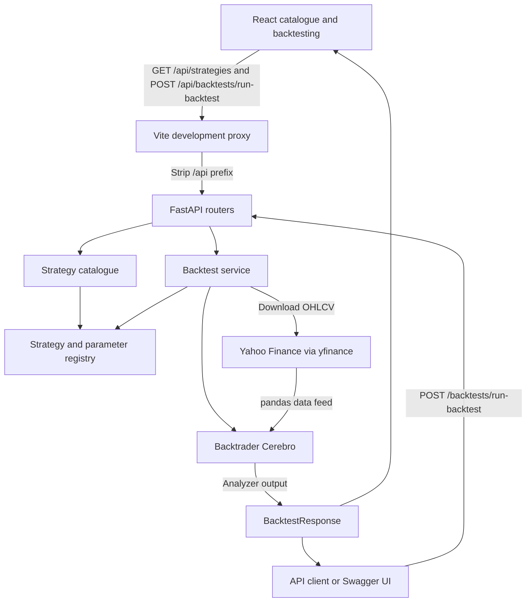

# Architecture

Hypothiq has two applications: a React/TypeScript client built with Vite and a
Python FastAPI service using Backtrader, pandas, and `yfinance`. There is no
database or background-job infrastructure in the current implementation.

## Product scope

Hypothiq is intended to support researching, sharing, creating, and testing
algorithmic trading strategies. This scope guides the architecture and
[roadmap](roadmap.md); it does not imply that all capabilities are implemented.
Today, users can discover predefined strategies and test them on historical
market data in the browser or through the API. Strategy creation and sharing
are planned work.

## Components and boundaries

The browser consumes the catalogue and backtest endpoints. The backtest API is
also usable independently through Swagger UI or an HTTP client. Frontend-to-backend
requests use the proxy contract described under
[deployment assumptions](#deployment-assumptions); Vite supplies this proxy
during local development.

| Location | Responsibility |
| --- | --- |
| `frontend/src/App.tsx` | Page selection and shared navigation, header, and footer. |
| `frontend/src/Home.tsx` | Platform introduction and links to catalogue and backtesting. |
| `frontend/src/StrategyCatalog.tsx` | Catalogue search, sorting, and expandable parameter tables. |
| `frontend/src/Backtesting.tsx` | Metadata-driven configuration, submission, and aggregate results. |
| `frontend/src/hooks/useStrategyCatalog.ts` | Cancellable catalogue loading and retry shared by both workspaces. |
| `frontend/src/api/strategies.ts` | TypeScript response types and cancellable catalogue fetch. |
| `frontend/src/api/backtests.ts` | Typed backtest requests/results and HTTP error handling. |
| `frontend/vite.config.ts` | React tooling and the local `/api` proxy to port 8000. |
| `backend/src/main.py` | FastAPI application, router registration, and health endpoint. |
| `backend/src/routers/` | HTTP request/response boundaries and service calls. |
| `backend/src/dto/` | Pydantic request, catalogue, and backtest result models. |
| `backend/src/registry.py` | Strategy registration, sizer/indicator lookup, and parameter resolution. |
| `backend/src/strategy_catalog.py` | Display metadata derived from strategy defaults with explicit overrides. |
| `backend/src/services/backtest_service.py` | Price acquisition, engine setup, execution, and result mapping. |
| `backend/src/precoded_strategies/single_asset/` | Predefined Backtrader strategies. |
| `backend/data/` | Sample CSVs; the HTTP backtest flow uses Yahoo downloads instead. |
| `backend/test/` | Tests with mocked downloads and small real Backtrader runs. |

## Catalogue flow

1. React fetches `/api/strategies` and cancels obsolete requests on effect cleanup.
2. The router obtains registered classes without instantiating them or downloading data.
3. The catalogue reads declared defaults, including inherited parameters. It
   infers scalar types and converts indicator classes to registry names suitable
   for JSON. Explicit metadata supplies descriptions, bounds, type overrides,
   and types that cannot be inferred from a default such as `None`.
4. The UI searches names, identifiers, descriptions, and parameter names/labels,
   sorts by display name, and renders the returned definitions.

`class_name` is the execution identifier; `name` is the display label. Catalogue
choices are suggestions and bounds are descriptive metadata. They do not add
execution validation rules. Strategies remain responsible for their own domain
constraints.

## Backtest flow

The browser loads strategy metadata, validates required fields, parameter bounds,
and date order, and posts to `/api/backtests/run-backtest`. Human percentage
inputs are converted to fractions for commission and percentage slippage;
`PercentSizer` uses percentage units directly. Browser runs use daily bars.

1. FastAPI validates the body as a `BacktestRequest`. Starting cash must be positive.
2. The service resolves the strategy, sizer, and parameter names before requesting
   prices. Unknown names raise `ValueError`. Class-valued indicator parameters
   resolve through the corresponding Backtrader namespace; ordinary values pass
   through without range validation by the resolver.
3. `yfinance` downloads one ticker's OHLCV data. Missing or empty downloads raise
   `ValueError`; a pandas-backed feed carries the requested date window.
4. A fresh `Cerebro` receives the feed, strategy, sizer, cash, commission, and
   slippage settings. Percentage slippage takes precedence if both modes are supplied.
5. Backtrader runs the strategy with Returns, SharpeRatio, TradeAnalyzer, and
   DrawDown analyzers. The service returns aggregate metrics in `BacktestResponse`.
6. The router maps `ValueError` to HTTP 400. Other unhandled failures propagate as
   server errors. See the [API reference](api.md) for response semantics.

The route uses a synchronous function, so FastAPI executes it in its thread pool.
The request waits for the download and backtest; there is no queue, progress
endpoint, cancellation contract, or stored result identifier. Each invocation
constructs its own engine and does not mutate the submitted request.

## Execution and data assumptions

- One ticker and one data feed are supported per API backtest.
- Market orders normally fill on the next bar. The API does not force liquidation
  at the final bar. Ending portfolio value includes open positions, while
  closed-trade count excludes them.
- `SimpleBollingerBandsBreakout` issues a buy or sell on every qualifying bar;
  it can accumulate positions or enter shorts. It does not share the
  position-gated behavior of the simpler long-only strategies.
- `BollingerBreakout` manages pending orders and optional short entries. Its loss
  threshold is checked against closing prices and submits a market exit; it is
  not a resting stop order. Its histories remain internal and are not API outputs.
- Yahoo's download end date is exclusive. Download defaults are inherited from
  `yfinance`; the service does not explicitly set an adjustment policy or cache
  data. Repeat runs are not guaranteed to use an identical dataset.
- Feed construction does not set timeframe/compression from the requested
  interval. Sharpe analysis explicitly uses daily periods; annualized metrics
  for other intervals need further validation.
- Validation covers DTO types, positive cash, name resolution, missing data, and
  constraints implemented by individual strategies. There is no complete shared
  validation of date ordering, provider intervals, OHLCV quality, or warm-up length.

## Deployment assumptions

The intended production topology connects the frontend and backend through a
reverse proxy. Nginx is the most likely implementation, but the final proxy
choice remains open. The deployment contract is:

- The reverse proxy exposes a single public origin and serves the built
  frontend assets, with `index.html` fallback for frontend page routes.
- The browser uses relative `/api/*` URLs on that origin for backend requests.
- The proxy forwards these requests to FastAPI after stripping the `/api`
  prefix. For example, `/api/strategies` becomes `/strategies` on the backend.
- Vite's proxy provides equivalent API routing during development; it is not
  included in the production bundle.

These are deployment assumptions, not an implemented production setup. No
production reverse-proxy configuration is currently included in the repository.

## Current boundaries and future changes

The current service has no authentication, persistence, custom code uploads, or
live broker integration. `backend/Dockerfile` is a placeholder that runs `top`;
it does not package or serve Hypothiq.

The [roadmap](roadmap.md) adds result histories and visualizations next,
then comparison and multi-asset support. Accounts and saved research require
persistence. User-supplied and AI-generated Python require isolated execution
with resource limits before those features can be introduced.
